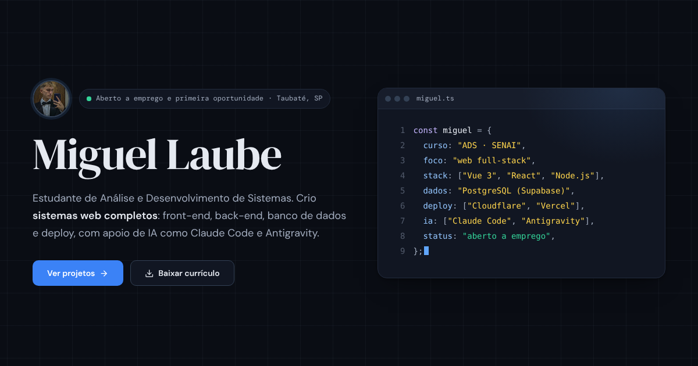

<p align="center">
  
</p>

<h1 align="center">Miguel Viana Laube · Portfólio</h1>

<p align="center">
  <em>Portfólio de página única feito com HTML, CSS e JavaScript puros, sem frameworks e sem build.</em><br />
  <a href="https://miguuellaube.github.io/portifolio/"><strong>miguuellaube.github.io/portifolio</strong></a>
</p>

<p align="center">
  
  
  
</p>

---

## Sobre

Portfólio de **Miguel Viana Laube**, estudante de **Análise e Desenvolvimento de Sistemas** no
SENAI Félix Guisard (Taubaté, SP), com foco em desenvolvimento web full-stack e aberto a emprego e primeira oportunidade em TI.

O site reúne:

- **Hero** com status de disponibilidade, resumo e um card de código que se "digita" sozinho
- **Sobre** com objetivo e qualificações
- **Projetos** com prints reais de cada sistema, stack e links para site e código
- **Skills** agrupadas por área (linguagens, front, back, banco, deploy, IA, infraestrutura)
- **Formação**, cursos complementares e idiomas
- **Contato** com e-mail (botão de copiar), LinkedIn, GitHub, WhatsApp e download do currículo

## Projetos em destaque

| Projeto | O que é | Stack |
|---|---|---|
| **EncoMed** | SaaS de encomendas para drogarias, com WhatsApp automático e IA para NF-e | Vue 3, TypeScript, Pinia, Supabase (RLS), Cloudflare Workers, Evolution API, Gemini |
| **MRD Andaimes** | Gestão de locação de andaimes e site com calculadora de torre 3D | React, Next.js, TypeScript, Tailwind, Supabase, Recharts, Cloudflare Workers |
| **SIGAF** | Gestão de atividades funcionais · Desafio SAGA SENAI 2026 (equipe de 5) | Node.js, Express, JWT, Vue 3, Pinia, PostgreSQL, testes automatizados |
| **CorrenteCão** | Adoção animal conectando ONGs, abrigos e tutores | React, TypeScript, Tailwind, Supabase, Gemini, Vercel |
| **AutoReq** | Gestão e validação de requisitos de software | PHP, JavaScript, HTML, CSS, MySQL (AWS RDS) |
| **EcoRoute** | Mapa de pontos de coleta e reciclagem de Taubaté | HTML, CSS, JavaScript, Leaflet, PHP, MySQL (AWS RDS) |
| **Trena** | Guia interativo de responsividade | Vue 3, Vite |

Outros: API de Figurinhas (FastAPI), Jogo do Mario e Outlet Senai (JavaScript).

## Como foi feito

- **Design system** documentado em [`DESIGN.md`](DESIGN.md): cores com papel definido, escala
  tipográfica fluida (DM Serif Display, DM Sans e DM Mono), espaçamento em base 4, raios e sombra.
  Tudo vira variável CSS em `style.css`.
- **Tema escuro e claro**: segue o sistema na primeira visita e lembra a escolha do botão.
- **100% responsivo**, mobile-first: menu hambúrguer no celular, grades que se reorganizam em
  celular, tablet e desktop, imagens com `srcset` (640 px e 1280 px, em WebP) e sem rolagem horizontal.
- **Animações** leves com CSS + `IntersectionObserver`: entrada em cascata do hero, digitação do
  card de código, faixa de tecnologias em loop, revelação ao rolar, chips em cascata, zoom nos prints,
  barra de progresso de leitura e menu que marca a seção atual.
- **Acessibilidade**: link "pular para o conteúdo", foco visível em tudo, `aria-expanded` no menu,
  textos alternativos nos prints e `prefers-reduced-motion` respeitado (todas as animações desligam).

## Estrutura

```
portifolio/
├── index.html                # página
├── style.css                 # estilos (tokens no topo)
├── script.js                 # tema, menu, animações, copiar e-mail
├── DESIGN.md                 # decisões de design
├── foto.jpg                  # foto de perfil
├── CurriculoMiguelLaube.pdf  # currículo para download
└── assets/
    ├── favicon.svg
    ├── og.png                # imagem de compartilhamento (1200×630)
    └── projetos/             # prints dos projetos (WebP)
```

## Rodar localmente

```bash
git clone https://github.com/MiguuelLaube/portifolio.git
cd portifolio
python3 -m http.server 8000   # ou abra o index.html direto no navegador
```

## Contato

[LinkedIn](https://www.linkedin.com/in/miguel-laube-67540333a/) ·
[GitHub](https://github.com/MiguuelLaube) ·
[miguuel.laube@gmail.com](mailto:miguuel.laube@gmail.com)
